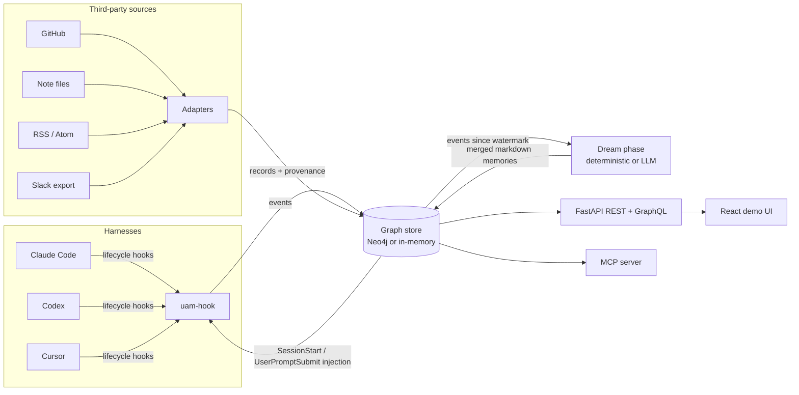

# Unified Agent Memory

**One memory layer under every agent harness — and every source it learns from.**

Coding agents (Claude Code, OpenAI Codex, Cursor) each keep their own
walled garden of context. Switch tools and you start from zero. This
repository builds the alternative: a single, user-owned memory graph
(Neo4j, or an identical in-memory store) fed by **lifecycle hooks** from
all three harnesses *and* by **adapters to third-party data sources** —
GitHub, note files, RSS feeds, Slack exports — so a fact learned from a
pull request, a Slack thread, or a note becomes memory that an agent in
*any* harness recalls at session start. Memory belongs to the user, not
the tool.

> **Attribution.** The hook-based design follows "Unified Agentic Memory
> Across Harnesses Using Hooks" (Towards Data Science):
> https://towardsdatascience.com/unified-agentic-memory-across-harnesses-using-hooks/
> That article implements hooks only, against Neo4j. **What this repo
> adds:** the third-party **source-adapter layer** with provenance, the
> **MCP access server**, a **deterministic offline dream phase** (plus an
> optional LLM distiller behind a provider seam), the **REST + GraphQL
> API and demo UI**, a per-harness **config generator**, a simulation
> CLI, and a **measured experiment suite**.

Everything below runs **offline, with no API keys**. Neo4j and the LLM
distiller are opt-in upgrades behind the same interfaces.

## Measured results (real runs — see experiments/RESULTS.md)

| Experiment | Result |
|---|---|
| E1 Cross-harness continuity | 12 seeded facts (9 from harness prompts across 3 harnesses, 3 existing *only* in GitHub/Slack/RSS) → **12/12 recalled** in a fresh session in a different harness |
| E2 Adapter ingestion | 16 records from 4 adapters; second pass dedup rate **1.00**; provenance completeness **100%** |
| E3 Dream merge | contradictory facts → 1 note, 1 fact, latest value wins, stale value gone |
| E4 Hook latency | in-process mean **0.029 ms** / p95 **0.08 ms** per event; full subprocess (what a harness pays) mean **0.082 s** |
| E5 Retrieval quality | precision@3 **0.875** on 8 seeded queries — the one miss is a synonym query (lexical search, no embeddings; see Limitations) |

Reproduce: `python3 experiments/run_experiments.py`.

## Architecture



Three layers, as in the article:

1. **Hooks (online)** — `uam-hook` is a single entrypoint; thin
   per-harness configs pass `--client`. Every lifecycle event
   (`SessionStart`, `UserPromptSubmit`, `PreToolUse`, `PostToolUse`,
   `Stop`) is appended to the session's event timeline. No model calls:
   hooks stay fast and deterministic.
2. **Dream phase (offline)** — a batch job reads events since the last
   watermark and distills them into durable markdown memories at
   semantic paths (`profile/role.md`, `tools/git.md`,
   `project/<name>.md`, `sources/<source>.md`) with YAML frontmatter.
   Merge rather than append: a contradicting fact *rewrites* the note.
3. **Injection (online)** — `SessionStart` output is prepended to the
   system prompt (profile memories live there); `UserPromptSubmit`
   output is appended to the user prompt (turn-relevant memories,
   retrieved by the built-in lexical search).

The extension is the second input column: **adapters** normalize
third-party sources into the same graph. Every record becomes an event
in its source's ingest session with a `SOURCED_FROM` edge to a `Source`
node, and the dream phase distills records with the same machinery as
hook events — so provenance survives into the memories themselves.

## Quickstart

```bash
pip install -e .                 # core (PyYAML only)
python3 examples/quickstart.py   # hooks in -> dream -> recall in another harness
python3 -m pytest tests/         # 43 tests
python3 validate.py              # harness: imports, tests, gates, docs
```

### Install the hooks

Generate a ready-to-install config for your harness and drop it in
place:

```bash
uam-config claude-code   # -> .claude/settings.json
uam-config codex         # -> .codex/hooks.json
uam-config cursor        # -> .cursor/hooks.json
```

Set `UAM_STATE_FILE=/path/to/state.json` so separate hook processes
share one memory, or run Neo4j (below) and set `NEO4J_URI`.

**Per-harness honesty:** Claude Code and Codex expose all five events
and both injection points. Cursor's hook surface differs — it has
`beforeSubmitPrompt` (which can only allow/block, never append context)
and no session-start hook. The Cursor config therefore logs everything
(prompt, shell, file events) and reads memory back through the MCP
tools; `uam-export-cursor-rules` also snapshots the profile memories
into `.cursor/rules/uam-memory.mdc`. That asymmetry is a property of
Cursor's contract, documented here rather than papered over.

### Run it on Neo4j

```bash
docker compose up neo4j          # browser on :7474, bolt on :7687
NEO4J_URI=bolt://localhost:7687 NEO4J_PASSWORD=unifiedmemory uam-dream
```

`Neo4jStore` implements the article's graph: `(:Session)` nodes with a
`[:NEXT]` linked list of `(:Event)` nodes, `(:Memory)` documents, and
`(:Source)` provenance edges. `GraphStore` is a protocol; the
in-memory implementation has identical semantics and is what tests,
experiments and the demo run on.

### Adapters

```bash
uam-ingest github octocat hello-world   # repo, issues, PRs, commits (REST; token optional)
uam-ingest files ~/notes                # markdown/text notes in a directory
uam-ingest rss https://example.com/feed.xml
uam-ingest slack ~/slack-export.json    # export dir or combined JSON
```

Writing one is a 20-line job: implement `fetch() -> list[SourceRecord]`
and set a stable `source` — see `src/unified_agent_memory/adapters/`.
Dedup is by stable record id, so polling is idempotent.

### Access layer: API, GraphQL, MCP, demo UI

```bash
pip install -e ".[server]"
uam-serve                            # REST at /api/*, GraphQL at /graphql
cd web && npm install && npm run dev # React demo UI (proxies to :8000)
uam-mcp                              # MCP server on stdio: memory_search / get / store / update / delete / list
```

`render.yaml` deploys both tiers on Render; the API seeds itself with
the experiment fixtures (`UAM_SEED_FIXTURES`) so the demo shows the
cross-harness scenario and all four adapters with no external services.

## Simulation

`uam-simulate` replays a scripted event stream (JSON fixtures) through
the real hook entrypoint as subprocesses — experiments are end-to-end
runs, not mocks:

```bash
uam-simulate experiments/fixtures/e1_stream.json --state /tmp/state.json --show-output
```

## Layout

- `src/unified_agent_memory/` — models, stores (`store.py`), hook
  runtime (`hooks.py`), config generators (`hook_configs.py`), dream
  phase (`dream.py`), provider seam (`providers.py`), search
  (`search.py`), adapters (`adapters/`), access layer (`server/`,
  `mcp_server.py`), CLIs (`cli.py`)
- `tests/` — 43 tests: store semantics, hook contracts per harness,
  dream merge/contradiction, all four adapters, API + GraphQL, MCP
- `experiments/` — fixtures, `run_experiments.py`, `results.json`,
  `RESULTS.md`
- `web/` — React demo UI; `docs/` — project page

## Limitations (honest)

- Retrieval is lexical keyword search — no stemming, no embeddings.
  E5's synonym query scores zero; a vector index is future work, not
  hidden debt.
- The deterministic distiller extracts *explicit* facts and usage
  patterns; it does not summarize free prose. The LLM distiller exists
  behind the provider seam but is optional and unmeasured here.
- Neo4j parity is by construction (same protocol, the article's graph
  model); the automated suite runs against the in-memory store.
- Cursor cannot receive prompt-time injection (its contract forbids
  it); it is a first-class citizen for logging and MCP access only.

MIT licensed. Author: Ranadhir Ghosh — https://github.com/ranadhir19
